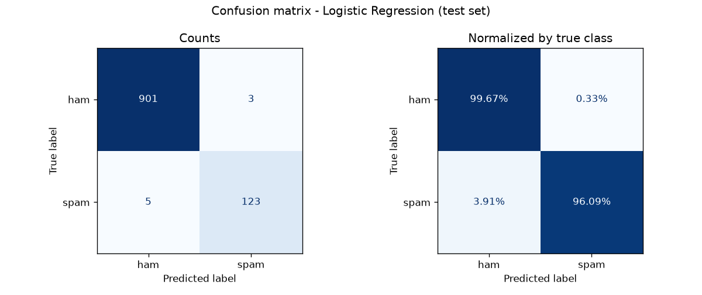

# SMS Spam Classifier

Detects spam SMS messages using TF-IDF features (word + character n-grams) and a Logistic Regression classifier.
Built for **Task 2** of the Arithmatrix Virtual Internship Program (AVIP) 2026, AI/ML Engineering track.

| Metric (test set, 1,032 messages) | Score |
|---|---|
| Accuracy | **99.22%** |
| Spam precision | **97.62%** |
| Spam recall | **96.09%** |
| Spam F1-score | **96.85%** |
| ROC-AUC | **0.9988** |

Only **3** legitimate messages were wrongly blocked and **5** spam messages slipped through.



---

## Summary

The goal was to classify SMS messages as **spam** or **ham** (legitimate).

**Data.** The UCI SMS Spam Collection contains 5,574 English messages. After removing duplicates, 5,160 remain, with only 12.4% spam. Because the classes are imbalanced, a model that always predicts "ham" would already score 87% accuracy, so precision, recall and F1 on the spam class were used as the main metrics.

**Preprocessing.** Messages are lowercased, and URLs, phone numbers, money amounts and other numbers are replaced with placeholder tokens (`urltoken`, `phonetoken`, `moneytoken`, `numtoken`). The exact number does not matter for spam detection; the fact that a phone number or prize amount appears does.

**Features.** Two TF-IDF views are combined: word unigrams/bigrams capture phrases such as "call now", while character 3–5-grams catch obfuscated spellings such as "fr33" or "W1N".

**Model selection.** Naive Bayes, Logistic Regression and a calibrated Linear SVM were compared with 5-fold stratified cross-validation on the training set only. Logistic Regression achieved the best F1 and was retrained on the full training set. The 20% test set was kept untouched until the final evaluation.

**Results.** On the test set the model reaches 99.22% accuracy and 96.85% spam F1, with 3 false positives and 5 false negatives. Misclassified messages are exported to `outputs/misclassified.csv` for error analysis.

**Trade-off.** For a spam filter, blocking a real message is worse than letting a spam through, so precision matters more. The decision threshold can be raised with `--threshold` to reduce false positives further.

---

## Dataset

- **Source:** [UCI Machine Learning Repository – SMS Spam Collection](https://archive.ics.uci.edu/dataset/228/sms+spam+collection) (Almeida & Hidalgo, 2011)
- Also available on Kaggle as *SMS Spam Collection Dataset* (`spam.csv`). The loader accepts either file.

Download it into `data/` (PowerShell):

```powershell
Invoke-WebRequest "https://archive.ics.uci.edu/static/public/228/sms+spam+collection.zip" -OutFile data\sms.zip
Expand-Archive data\sms.zip -DestinationPath data -Force
```

## Project structure

```
AIML_2_SpamClassifier_byte/
├── data/               # dataset + saved test split
├── models/             # spam_classifier.joblib, model_info.json
├── outputs/            # plots, metrics, predictions
├── src/
│   ├── data_utils.py   # loading, cleaning, text normalization
│   ├── explore.py      # EDA plots
│   ├── train.py        # model comparison + training
│   ├── evaluate.py     # test metrics, confusion matrix, error analysis
│   └── predict.py      # CLI inference
└── requirements.txt
```

## How to run

Requires Python 3.10+.

```bash
python -m venv .venv
# Windows: .venv\Scripts\activate    |    macOS/Linux: source .venv/bin/activate
pip install -r requirements.txt

python src/explore.py     # 1. explore the data
python src/train.py       # 2. compare models and train the best one
python src/evaluate.py    # 3. evaluate on the held-out test set
```

## Inference

The trained model is included at `models/spam_classifier.joblib`, so you can predict without retraining.

```bash
# classify one or more messages
python src/predict.py "WINNER! Claim your free prize, call 09061701461" "See you at dinner"

# 10 test-set samples with ground truth -> outputs/example_predictions.csv
python src/predict.py --demo

# interactive mode (type q to quit)
python src/predict.py

# stricter filter: fewer false positives
python src/predict.py --threshold 0.7 "your message"
```

Example output of `--demo`:

```
🚫 SPAM   98.1%  (true: spam ✓)  | Had your contract mobile 11 Mnths? Latest Motorola, Nokia etc. all ...
✅ HAM    99.8%  (true: ham  ✓)  | Hi dear we saw dear. We both are happy. Where you my battery is low
🚫 SPAM  100.0%  (true: spam ✓)  | * FREE* POLYPHONIC RINGTONE Text SUPER to 87131 to get your FREE PO...
✅ HAM    98.3%  (true: ham  ✓)  | I gotta collect da car at 6 lei.
```

## Outputs

| File | Content |
|---|---|
| `01_class_distribution.png`, `02_message_length.png`, `03_top_words.png` | Exploratory analysis |
| `model_comparison.csv` | Cross-validation scores of the 3 models |
| `04_confusion_matrix.png` | Confusion matrix (counts + normalized) |
| `05_precision_recall.png` | Precision-recall curve |
| `metrics.json` | Final test metrics |
| `misclassified.csv` | Every wrong prediction, for error analysis |
| `example_predictions.csv` | 10 sample predictions with probabilities |

## Tech stack

Python · pandas · scikit-learn · matplotlib · seaborn · joblib
